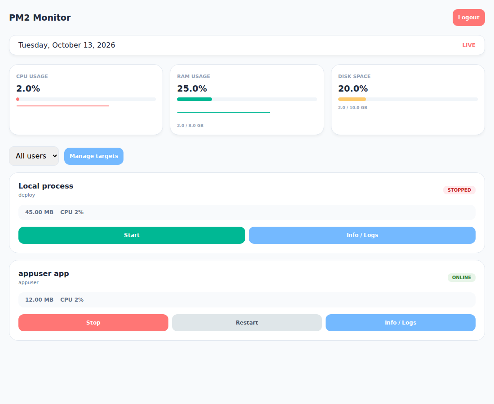
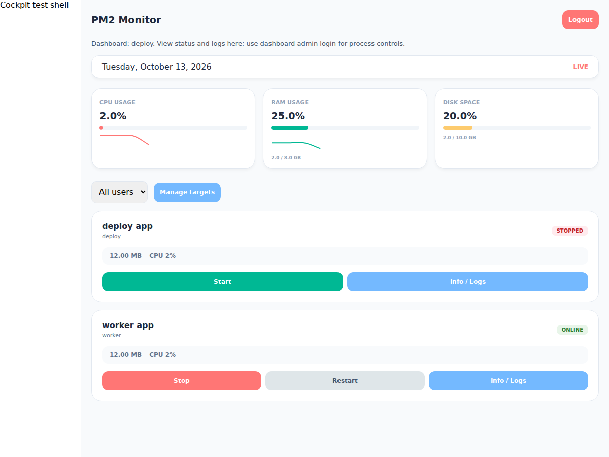

<sub>This repo is folked from <a href="https://github.com/keizaken/pm2-monitor">https://github.com/keizaken/pm2-monitor</a></sub>

# PM2 Monitor and Cockpit Plugin

README có 2 phần: [Tiếng Việt](#vietnamese) và [English](#english). / This README has two sections: Vietnamese and English.

<a id="vietnamese"></a>

## Tiếng Việt

Dashboard nhẹ để xem trạng thái server, theo dõi process PM2 và điều khiển app trên web hoặc ngay trong Cockpit.



*Hình minh họa với dữ liệu mẫu.*

### App làm được gì?

- Xem CPU, RAM, disk của server và CPU/RAM của từng process.
- Xem trạng thái, biểu đồ và log của app.
- Start, stop, restart, đổi tên hoặc xóa process khỏi PM2.
- Theo dõi PM2 của một user hoặc gom nhiều dashboard, lọc theo user.
- Hiển thị trực tiếp trong Cockpit.

Status và log xem được không cần login admin. Các thao tác thay đổi cần mật khẩu admin dashboard. Trong Cockpit cũng giữ cách này: login Cockpit để vào xem, login admin dashboard để điều khiển.

### Setup và chạy

Cần Linux, Node.js **>= 20.19** và npm. Nếu dùng NVM, chọn phiên bản Node trước. Chạy bằng user quản lý PM2, không dùng sudo/root.

```bash
git clone https://github.com/fenita201/pm2-monitor.git
cd pm2-monitor
./start.sh
```

Script tự cài dependency nếu thiếu và chạy setup trước:

- Đã có `.env`: Enter để giữ nguyên; nhập `no` để tạo lại toàn bộ.
- Chưa có `.env`: tạo mới; Enter ở từng câu hỏi để dùng default.
- Mode: `1` = single-user (default), `2` = multi-user.
- Mặc định port `8877`, mật khẩu admin `admin123`, session secret tự sinh. Có thể nhập mật khẩu riêng khi setup.
- Cách chạy: Enter/`1` = foreground, `2` = chạy bằng PM2.

Mở **http://<server-ip>:8877**, hoặc port đã chọn. Với foreground, Ctrl+C để dừng.

### Các command

| Command | Dùng để |
| --- | --- |
| `./setup.sh` | Tạo hoặc kiểm tra `.env`. |
| `./start.sh` | Setup rồi chọn chạy foreground hoặc PM2. |
| `./reload.sh` | Reload dashboard đang chạy bằng PM2, nạp lại cấu hình. |
| `./stop.sh` | Enter/`1`: stop; `2`: remove dashboard khỏi PM2. |
| `./install-cockpit-plugin.sh` | Cài plugin Cockpit cho user hiện tại. |
| `npm run check-config` | Kiểm tra cấu hình và kết nối PM2/targets. |
| `npm test` | Chạy test tự động. |

Các script PM2 chỉ thao tác process `pm2-dashboard`, dùng `PM2_HOME` theo cấu hình.

### Theo dõi nhiều user

1. Mỗi user chạy một dashboard **single-user**, dùng port riêng.
2. Dashboard tổng chọn **multi-user** khi setup.
3. Login admin trên dashboard tổng, mở **Manage targets**, thêm username, URL/port và mật khẩu dashboard đích.

Không nhập mật khẩu target thì chỉ xem status/log. Các dashboard kết nối qua HTTP(S); không cần sudo để gom dữ liệu.

### Cài vào Cockpit

Plugin hiển thị dashboard ngay trong vùng nội dung Cockpit, giữ menu Cockpit bên cạnh. Có thể dùng app độc lập trên web hoặc mở trong Cockpit.



*Giao diện plugin trong khung Cockpit mô phỏng, dùng dữ liệu mẫu.*

Chạy trong repo bằng đúng user đăng nhập Cockpit:

```bash
./install-cockpit-plugin.sh
# Xem trước hoặc chọn port khác:
./install-cockpit-plugin.sh --dry-run
./install-cockpit-plugin.sh --port 8888
```

Refresh hoặc logout/login Cockpit, mở **Tools → PM2 Monitor**. Backend dashboard cần đang chạy. Plugin mặc định kết nối tới `127.0.0.1:<PORT>` trên server; không cần browser truy cập trực tiếp port dashboard. Refresh trang plugin cần login admin dashboard lại.

### Cập nhật

```bash
git pull --ff-only
npm ci --omit=dev
./reload.sh                       # Nếu đang chạy bằng PM2
./install-cockpit-plugin.sh        # Nếu dùng Cockpit
```

Nếu chạy foreground, dừng bằng Ctrl+C rồi chạy lại `./start.sh`. Giữ `.env` hiện có khi setup; chạy lại installer Cockpit để cập nhật giao diện.

---

<a id="english"></a>

## English

A lightweight dashboard for viewing server status, monitoring PM2 processes, and managing apps on the web or directly inside Cockpit.


*Dashboard preview with sample data.*

### What can it do?

- View server CPU, RAM, and disk usage, plus CPU/RAM usage for each process.
- View app status, charts, and logs.
- Start, stop, restart, rename, or remove processes from PM2.
- Monitor one user's PM2 or combine multiple dashboards and filter by user.
- Display the dashboard directly inside Cockpit.

Status and logs are available without dashboard admin login. Changes require the dashboard admin password. Cockpit follows the same flow: log in to Cockpit to view the page, then log in as dashboard admin to manage processes.

### Setup and run

Requires Linux, Node.js **>= 20.19**, and npm. If using NVM, select your Node version first. Run as the user managing PM2, without sudo/root.

```bash
git clone https://github.com/fenita201/pm2-monitor.git
cd pm2-monitor
./start.sh
```

The script installs missing dependencies and runs setup first:

- Existing `.env`: press Enter to keep it, or type `no` to recreate the entire file.
- No `.env`: create one; press Enter at each prompt to use the default.
- Mode: `1` = single-user (default), `2` = multi-user.
- Defaults: port `8877`, admin password `admin123`, and an automatically generated session secret. You can enter your own password during setup.
- Run mode: Enter/`1` = foreground, `2` = PM2.

Open **http://<server-ip>:8877**, or your chosen port. Use Ctrl+C to stop foreground mode.

### Commands

| Command | Purpose |
| --- | --- |
| `./setup.sh` | Create or validate `.env`. |
| `./start.sh` | Run setup, then choose foreground or PM2. |
| `./reload.sh` | Reload the dashboard running under PM2 and apply configuration changes. |
| `./stop.sh` | Enter/`1`: stop; `2`: remove the dashboard from PM2. |
| `./install-cockpit-plugin.sh` | Install the Cockpit plugin for the current user. |
| `npm run check-config` | Check configuration and PM2/target connections. |
| `npm test` | Run automated tests. |

The PM2 scripts only manage `pm2-dashboard` and use the configured `PM2_HOME`.

### Monitor multiple users

1. Run a **single-user** dashboard for each user, using a different port.
2. Select **multi-user** during setup for the aggregate dashboard.
3. Log in as admin on the aggregate dashboard, open **Manage targets**, and add each target's username, URL/port, and dashboard password.

Without a target password, only status and logs are available. Dashboards connect over HTTP(S); aggregation does not require sudo.

### Install in Cockpit

The plugin displays the dashboard in Cockpit's content area, alongside its navigation menu. The app can run as a standalone web dashboard or be opened inside Cockpit.


*Plugin preview in a simulated Cockpit frame, using sample data.*

Run from the repository as the user who logs in to Cockpit:

```bash
./install-cockpit-plugin.sh
# Preview the installation or choose a different port:
./install-cockpit-plugin.sh --dry-run
./install-cockpit-plugin.sh --port 8888
```

Refresh or log out and back in to Cockpit, then open **Tools → PM2 Monitor**. The dashboard backend must be running. By default, the plugin connects to `127.0.0.1:<PORT>` on the server; the browser does not need direct access to the dashboard port. Refreshing the plugin page requires dashboard admin login again.

### Update

```bash
git pull --ff-only
npm ci --omit=dev
./reload.sh                       # If running under PM2
./install-cockpit-plugin.sh        # If using Cockpit
```

For foreground mode, stop with Ctrl+C and run `./start.sh` again. Keep your existing `.env` during setup; rerun the Cockpit installer to update the interface.
